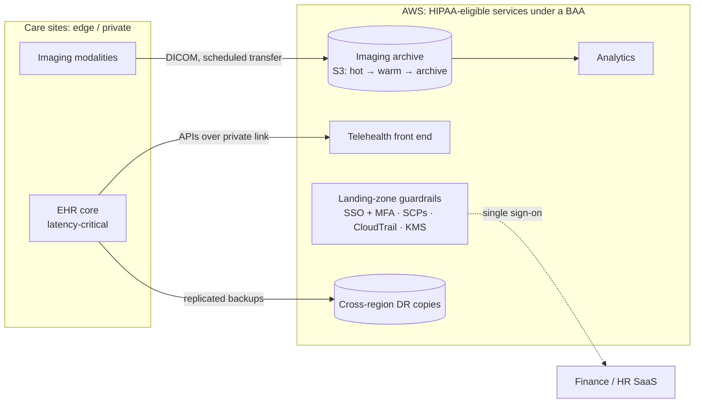

# Case 1: Hybrid-first cloud strategy for a regional health system

> **Client:** MediCare Regional Health System (fictional, CLCS 615 *Cloud Services and Technologies*)
> **My role:** cloud strategist / solutions architect
> **Decision in one line:** keep latency-critical clinical systems near care sites, move everything
> else to HIPAA-eligible public cloud, and earn the right to migrate with guardrails first.

## The situation

A regional hospital network runs on 5–7-year-old hardware with frequent downtime and an imaging
archive that is running out of space. Patients want telehealth, regulators want HIPAA/HITECH
evidence, and the CFO wants infrastructure costs down 20–30% on a $3.2M annual budget. The IT team
has 15 people, few of whom have cloud experience.

## Requirements and constraints

| Category | Requirement |
|---|---|
| Compliance | HIPAA Security Rule, HITECH, BAAs with every provider; NIST SP 800-66r2 / 800-53 controls |
| Performance | EHR p95 < 2 s; image retrieval p95 < 3 s cached, < 7 s archived |
| Availability | Tiered by criticality (below) |
| Cost | 20–30% infrastructure reduction; no runaway spend |
| People | Readiness scored 2/5 technical, 2/5 compliance; must train while migrating |

### Service tiers (SLAs set by business impact, not by technology)

| Tier | Systems | Availability | RTO | RPO | Incident response |
|---|---|---|---|---|---|
| Critical | EHR, PACS (imaging) | 99.9% | 4 h | 1 h | ≤ 1 h |
| Important | Finance, HR | 99.5% | 24 h | 4 h | ≤ 4 h |
| Standard | Email, collaboration | 99.0% | best effort | 24 h | next business day |

## Options considered

| Model | For | Against | Verdict |
|---|---|---|---|
| All public cloud | Elastic, managed DR, fastest | EHR latency to care sites; egress cost on imaging; big-bang risk | Too much risk at readiness 2/5 |
| Private cloud | Full control | High capex, needs skills the team lacks, no DR improvement | Fails the cost goal |
| **Hybrid-first, public-anchored** | Right workload in the right place; incremental | Integration complexity, two operating models | **Chosen** |
| Multi-cloud | No single-provider risk | Tool and skill sprawl for a 15-person team | Only selectively (analytics/AI), later |

## Architecture

## Roadmap

| Phase | Months | Exit criteria (governance gate) |
|---|---|---|
| 1. Foundation & guardrails | 0–3 | Landing zone, SSO + MFA for 100% of admins, central logs/SIEM, KMS, BAAs signed, data classification |
| 2. Administrative systems | 3–6 | Finance/HR on SaaS; first cost report by tag |
| 3. Clinical modernization | 6–12 | Imaging archive in S3 with lifecycle; p95 retrieval targets met |
| 4. Optimize & extend | 12+ | Multi-region DR test passed against tier RTO/RPO; commitments bought |

## Top risks

| Risk | Probability | Impact | Mitigation |
|---|---|---|---|
| PHI breach | Medium | High | MFA, least privilege, customer-managed keys, SIEM anomaly detection |
| Provider regional outage | Low | High | Cross-region DR for Critical tier, quarterly failover tests |
| Cost overrun | Medium | Medium | Budgets + alerts from day 1, tagging, showback |
| Vendor lock-in | Medium | Medium | DICOM and open standards, containers, IaC, contract exit clauses |

## What I'd do differently now

- **Make placement a rule, not a judgment call.** Publish a placement table keyed by data class and
  latency (for example "PHI + < 50 ms to clinicians → edge; PHI otherwise → cloud with CMK"), so
  each new system lands somewhere predictable.
- **Ask the EHR vendor first.** Most major EHRs now offer a vendor-hosted cloud option, and that
  changes the "keep EHR on-premises" assumption more than any architecture diagram.
- **Quantify the egress risk** for imaging before committing: modality → cloud is free, but
  cloud → referring clinics isn't. Case 2's TCO model has an egress line for exactly this.
- **Build the landing zone with AWS Control Tower + IaC** rather than by hand. The guardrails in
  [aws-security-guardrails-detection](https://github.com/Monkmode-tech/aws-security-guardrails-detection)
  are the account-level half of that.
