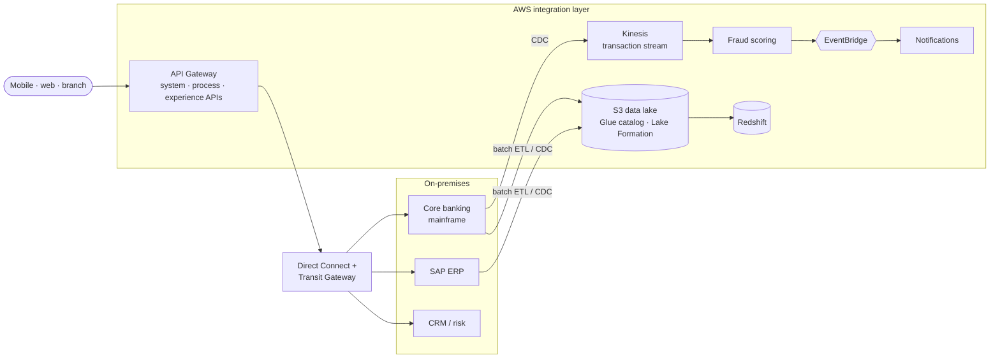

# Case 3: Hybrid integration for a bank: APIs, events and change data capture

> **Client:** Tetteh Financial Group (fictional, CLCS 625, Unit 5): retail and commercial banking,
> ~9M customers, ~20,000 staff, offices in New York, Chicago and London
> **My role:** integration architect
> **Decision in one line:** replace point-to-point links with three governed patterns: APIs for
> requests, events for reactions, CDC/ETL for data. Pick per use case, never one for everything.

## The situation

The system of record is a COBOL/CICS mainframe, alongside Oracle reporting, SAP ERP, on-premises
CRM and card authorization, and a growing AWS footprint. Systems are wired together point-to-point,
fraud insights arrive a day late via overnight batches, IAM is inconsistent, and nobody can see a
transaction end to end. Regulation (PCI DSS, SOX, GLBA, FFIEC, plus GDPR in the EU) demands
encryption, audit trails and retention everywhere.

## Pattern selection

| Need | Pattern | AWS building blocks | Why not the others |
|---|---|---|---|
| A channel asks a system something *now* (balance, loan status) | **API-led** (system → process → experience APIs) | API Gateway, OAuth2/OIDC scopes, OpenAPI contracts, `/v1/` versioning | Events don't give an answer; CDC is too slow for a request |
| Something happened that others must react to (transaction posted, fraud score) | **Event-driven** | EventBridge (routing), Kinesis (high-volume ordered streams), SQS + DLQ per consumer | Polling APIs wastes capacity and adds latency |
| Analytics and regulatory reports need consistent copies | **Batch ETL + CDC** | Glue, CDC into S3 data lake and Redshift, Lake Formation | Hitting the mainframe with queries is costly and risky |

Ultra-low-latency card authorization and ledger posting **stay on-premises** (systems of record).
Fraud scoring, notifications and analytics move to AWS (systems of innovation).

## Architecture

## Reliability rules for every integration

- Consumers are **idempotent**. Duplicate deliveries must not double-post.
- **Exponential backoff with jitter**, **circuit breakers** on synchronous calls, a **DLQ** per consumer.
- Contracts first: OpenAPI for APIs, versioned schemas for events, with drift detection.

## KPIs

| Area | Target |
|---|---|
| API availability / p95 latency | ≥ 99.9% / < 300 ms |
| Event processing success | ≥ 99.5%; EventBridge failed invocations < 0.5% |
| CDC replication lag | < 60 s |
| ETL on-time completion / data-quality pass rate | ≥ 99% / ≥ 98% |
| PCI data encrypted | 100% |
| MTTR | −30 to −40% |

## Built, not just designed

The event-driven half of this design is implemented end to end in
[**serverless-event-driven-timesheet**](https://github.com/Monkmode-tech/serverless-event-driven-timesheet).
It has a transactional outbox (DynamoDB Stream → EventBridge Pipe), one SQS queue and DLQ per
consumer, exactly-once processing via DynamoDB transactions, an event archive with replay, and
the p95 < 300 ms and DLQ alarms from the KPI table above. The private hybrid link is built in
[**aws-azure-hybrid-network**](https://github.com/Monkmode-tech/aws-azure-hybrid-network)
(IPsec + BGP, the same routing model as Direct Connect).

## What I'd do differently now

- **Outbox, not dual writes.** The coursework had services "publish events". The safer pattern is
  to derive events from committed writes (CDC or an outbox), which I later built.
- **Schema registry from day one** (EventBridge schema registry or Glue Schema Registry for
  Kinesis/MSK). Schema drift is the most common event-driven outage.
- **Choose Kinesis vs. EventBridge by numbers.** Ordered, high-throughput, replayable per shard
  (card transactions) → Kinesis or MSK. Content-based routing across many consumers → EventBridge.
- **Name the mainframe CDC tool.** CDC from Db2/IMS needs a specialized product (several are
  available through AWS Mainframe Modernization). It is a procurement item, not a checkbox.
