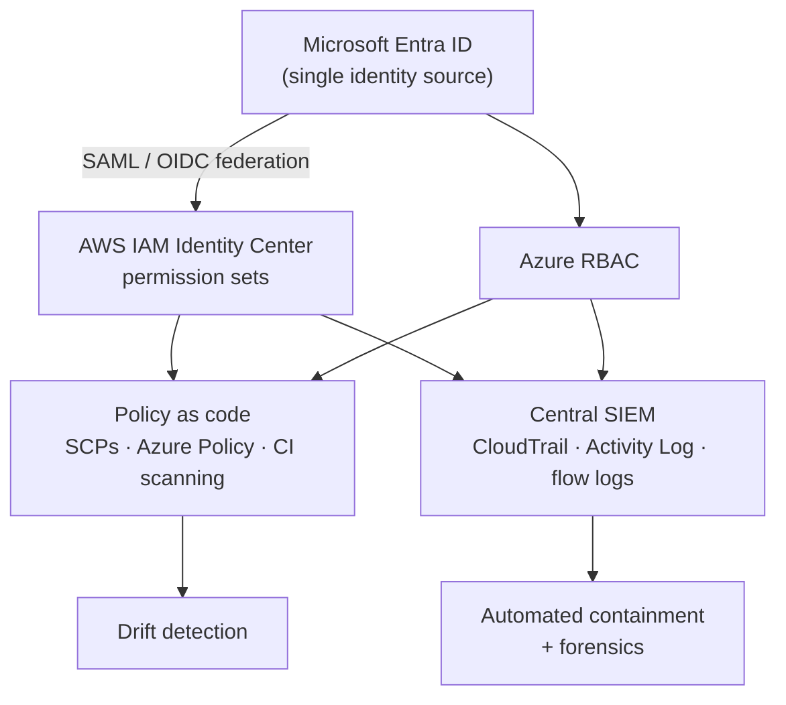

# Case 5: Governing an AWS + Azure estate through a 24-month transformation

> **Client:** Global Tech Industries (fictional, CLCS 625, Unit 7 capstone)
> **My role:** cloud governance / security architect
> **Decision in one line:** security, monitoring and governance mature *with* the migration, and
> each phase must pass a measurable gate before the next one starts.

## The situation

Only 40% of workloads run in a fragmented AWS + Azure estate. There is no unified identity, no
central SIEM, manual provisioning and region-by-region architectures. Legacy outages are frequent
and nobody can see cost. The goal is 80% in the cloud within 24 months under GDPR and SOC 2.

## Lifecycle roadmap with gates

| Phase | Months | Key work | Gate (measurable) |
|---|---|---|---|
| 0 Baseline | 0–3 | Architecture audit, GDPR/SOC 2 gap analysis, workload classification, KPI baseline | Executive sign-off on risk ranking and wave order |
| 1 Security & governance foundation | 3–6 | AWS ↔ Entra ID federation, mandatory MFA, least-privilege RBAC, cross-cloud SIEM, IaC provisioning, Cloud Center of Excellence | 100% MFA; 100% of accounts/subscriptions logging to the SIEM; policy-as-code in CI |
| 2 Secure migration wave 1 | 6–12 | Rehost stable workloads, parallel run, DevSecOps pipeline, drift detection | Zero critical findings open > 7 days; rollback rehearsed |
| 3 Cloud-native modernization | 12–18 | Containers, event-driven services, autoscaling, FinOps dashboards | Cost per workload reported; SLOs met for 30 days |
| 4 Optimize & predict | 18–24 | Anomaly detection, predictive capacity, automated cost policies, certification program | Quarterly security score trending up; 20–25% cost reduction |

## Zero Trust across two clouds

Five principles: verify identity on every request (federation + MFA + short-lived credentials);
least privilege with just-in-time elevation; micro-segmentation; encryption everywhere; and assume
breach (central detection, rehearsed response).

## Success metrics

| Area | Target |
|---|---|
| Security | 100% MFA; −60% identity incidents; containment < 15 min |
| Delivery | 40% faster deployments; −30% manual provisioning |
| Resilience | 99.99% for critical systems; RTO < 30 min; RPO < 15 min |
| Cost | 20–25% reduction; +15% cost transparency |
| Governance | 100% audit-logging coverage; quarterly compliance validation |

## Built, not just designed

| Governance capability | Where I implemented it |
|---|---|
| Cross-cloud network and identity federation design | [aws-azure-hybrid-network](https://github.com/Monkmode-tech/aws-azure-hybrid-network) (docs/identity-federation.md) |
| Account guardrails, detection, auto-remediation, CIS/FSBP standards | [aws-security-guardrails-detection](https://github.com/Monkmode-tech/aws-security-guardrails-detection) |
| DevSecOps gates, signed images, admission policies | [eks-devsecops-pipeline](https://github.com/Monkmode-tech/eks-devsecops-pipeline) |
| IaC with security scanning on every change | Every repository's CI (checkov, tflint) |

## What I'd do differently now

- **Write gates as automated checks, not meetings.** "100% MFA" becomes an IAM credential-report
  query; "logging coverage" becomes an AWS Config / Azure Policy compliance number. The meeting
  reviews the dashboard.
- **One CCoE backlog for both clouds.** Shared guardrail definitions, implemented per provider.
- **Be explicit about where multi-cloud adds value.** Running the same workload in both clouds
  rarely pays. Placing each workload in the right cloud, under one identity and one SIEM, does.
