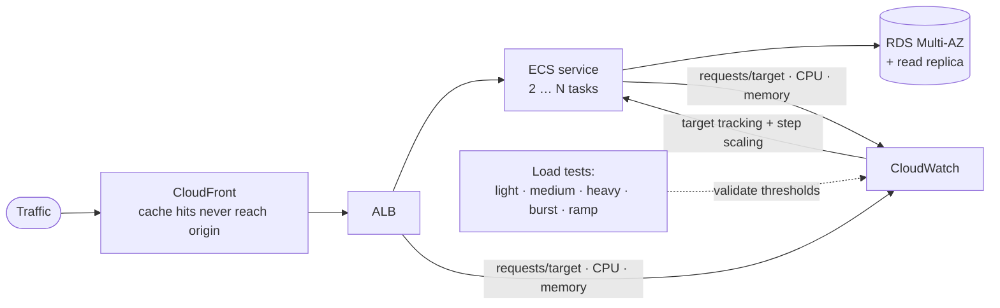

# Case 6: Elastic capacity for an e-commerce platform

> **Client:** Global E-Commerce Corporation (fictional, CLCS 645 *Cloud Infrastructure Planning and Design*, capstone)
> **My role:** infrastructure architect
> **Decision in one line:** stateless containers that scale on demand signals, with a database and
> CDN sized so the containers are never the only thing that scales.

## The situation

Promotions and holidays drive traffic up several-fold in minutes. A static fleet either falls
over during campaigns or wastes money the rest of the year. The baseline was a lab WordPress stack
(ECS, ALB, RDS), and the brief was to turn it into a production-grade blueprint.

## Scaling design

| Parameter | Lab | Production recommendation | Why |
|---|---|---|---|
| Minimum tasks | 1 | 2 | Survive a task replacement or AZ loss without an outage |
| Maximum tasks | 2–3 | 6+, set by load tests | Ceiling is a budget control, so make it explicit |
| CPU target | 10% (to demo scaling) | 55–65% | Utilization with headroom for the scale-out delay |
| Scale-out / scale-in cooldown | 60 s / 300 s | 60–120 s / 300–600 s | React fast to spikes; don't thrash or drop sessions |
| Signals | CPU | CPU + memory + **ALB requests per target**, step scaling for bursts | Requests rise *before* CPU does: a leading indicator |

## Assessment matrix

| Capability | Baseline | Target | Priority |
|---|---|---|---|
| Compute | CPU target tracking | CPU + memory + request-count tracking, step scaling for flash sales, scheduled scaling for known campaigns | High |
| Database | Single RDS instance | Multi-AZ, read replica for catalog reads, evaluate Aurora Serverless v2 | High |
| Content | All traffic to the ALB | CloudFront + S3 for static assets and cacheable pages | High |
| Monitoring | Dashboard + scripts | Alarms, anomaly detection, runbooks, budget alerts | High |
| Capacity planning | Manual, after tests | Monthly Compute Optimizer review; quarterly load-test baseline | Medium |
| Cost | Manual cleanup | Budgets, tags, lifecycle rules, IaC teardown | High |

## The control loop

## Three-year cost levers

| Lever | Year 1 | Year 2 | Year 3 | Benefit |
|---|---|---|---|---|
| Auto Scaling | Tune thresholds | Add request-count metric | Predictive scaling | No idle compute |
| Savings Plans | No commitment until baseline known | Commit the baseline | Rebalance | Lower cost for known demand |
| Spot | Evaluate non-critical jobs | Batch workers | Expand where fault-tolerant | Lower compute cost |
| CloudFront / S3 | Cache static assets | Optimize TTLs | Regional edge rules | Lower origin load and latency |
| Lifecycle | Logs to S3 | Transition old logs | Archive cold data | Less storage waste |

## Built, not just designed

[**aws-secure-three-tier-platform**](https://github.com/Monkmode-tech/aws-secure-three-tier-platform)
implements this design and adds what the blueprint only recommended:
- ECS Fargate (ARM64) with **both** CPU and ALB request-count target tracking
- WAF with rate limiting, Multi-AZ RDS with managed secrets, and alarms
- A **k6 load test plus a scaling watcher** that records real task counts and latency. The
  capstone's test results were simulated; these are measured.

## What I'd do differently now

- **Scale on requests first, CPU second.** CPU lags; by the time it crosses 60%, users already
  feel it. Request count per target is the earlier signal.
- **Load-test the database, not just the web tier.** Containers scale in a minute; connection
  limits and write capacity don't. RDS Proxy and read replicas belong in phase 1, not phase 3.
- **Report measured, not simulated, results.** That's why the portfolio build ships its own load test.
